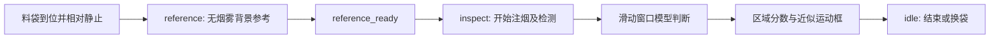

# 料袋密封检测：实时微弱烟雾试验流程

目标：海康机器人工业相机持续采集，在料袋相对静止的检测阶段判断疑似逸出烟雾，并尽可能定位发生变化的区域。准确率、检出率优先；不以低运动强度作为排除模型输入的条件。

**当前状态是可运行的集成试验代码。** 现有权重识别水蒸气，本次没有现场料袋泄漏数据，也没有连接实际工业相机。默认输出 `steam_proxy`，用于验证流程和收集对照结果，不能据此宣称烟雾已检出或料袋已通过密封检测。`confirmed` 只表示模型分数满足时间确认规则，不等于人工验证或已标定的泄漏结论。

## 检测周期



`reference` 必须位于注烟／可能泄漏之前；程序不会自动假定“刚开始检测的一秒就是无烟雾背景”。新一袋必须使用新的 `cycle_id` 并重新建立参考。检测结束即失效本袋结果；即使后台仍在计算，其旧结果也不会用于下一袋。

当前不直接读写 PLC 寄存器，也不向设备发送剔除或停机命令。提供原子 JSON 文件信号桥接和 Python `InspectionCycle.update(cycle_id, phase)` 接口；Modbus、TCP、数字 I/O 等现场协议需按设备接口接入。相机触发信号与检测周期信号是两个不同概念。

## 工作方式与默认值

1. 采集线程独立取图，按时间采样到有限长度内存缓存，不保存临时切片视频。
2. 默认保留最近 **5 秒**，约 **12 帧／秒**，从中抽取 **48 个不同图像帧**。完整窗口形成后，目标每 **1 秒**提交一次判断；首次判断需要窗口积累及推理时间。
3. 对指定 ROI 按 **512×512、20% 重叠**的固定网格全覆盖分类。保持每个时序窗口的裁剪位置一致，不只挑运动最强的 Top-K。
4. 默认 FP32、水平翻转增强，批量大小 2。推理忙时仅保留一个最新待处理窗口，避免任务队列持续积压；被替换任务数写入日志。无法覆盖每个瞬间的极短事件，需根据实测吞吐和烟雾持续时间决定相机数量与硬件配置。
5. 模型区域分数达到阈值后，利用帧间变化和同袋背景差异框出近似运动区域。运动定位失败时仍保留分类区域框 `[ROI]`，不会把“没有运动框”解释成“没有烟雾”。

默认模型阈值 0.5，连续两个已处理窗口命中后 `confirmed`；分数 ≥0.65 时可单窗口确认。连续三次低于 0.35 后清除确认状态。以上是可调整的初始参数，不是此场景验证过的最佳阈值；重叠窗口之间也并非独立证据。

## 先用视频验证

按总 README 安装依赖和下载权重，在仓库根目录执行：

```bash
python -m realtime.run --source data/packing_trial.mp4 \
  --device cuda --events outputs/realtime/trial.jsonl --show
```

文件按原帧率回放，用于模拟持续取图；CPU 可改为 `--device cpu`。默认是水蒸气 v8.1 PyTorch 权重，显示为 `steam_proxy`。无需连接相机即可验证缓存、推理及输出，但不能验证真实设备取图性能。

USB 摄像头用 `--source 0`；有 RTSP 的相机可用 `--source "rtsp://..."`。海康机器人工业相机优先使用以下 MVS 入口，不假定它具有 RTSP。

## 海康机器人 MVS 取图

1. 在实际连接相机的 Windows／Linux 工控机安装匹配的海康机器人 MVS 软件及 SDK，先确认官方客户端可以稳定取图。
2. 设置 `MVS_PYTHON_PATH` 指向安装 SDK 中包含 `MvCameraControl_class.py` 的 `MvImport` 目录。示例路径需以实际安装位置为准：

```bash
export MVS_PYTHON_PATH=/opt/MVS/Samples/64/Python/MvImport
```

3. 复制 `examples/hikrobot_camera.json` 到本地配置文件，填写相机序列号。适配器按序列号选择 GigE／USB 相机，不自动选择列表中第一台。

```json
{
  "serial": "实际相机序列号",
  "trigger_mode": "preserve"
}
```

`preserve` 保留相机已有触发模式。需要相机自由连续出图时，可显式改为 `continuous`，此选项会关闭相机硬件触发模式。程序保留已配置的曝光、增益、白平衡和像素格式；需在 MVS 客户端根据现场照明固定合适的参数，避免自动调整被误认为烟雾变化。海康的参数类型和节点操作说明见[厂家文档](https://www.hikrobotics.com/cn2/source/vision/video/2021/6/25/20210625082558512.pdf)。

```bash
python -m realtime.run --source local_camera.json \
  --adapter realtime.hikrobot:create_source --device cuda \
  --control-file outputs/realtime/cycle.json \
  --roi-config local_regions.json --show
```

SDK 适配器进行像素格式转换，在释放 SDK 图像缓存前复制 BGR 数据。源码不包含厂家 SDK、驱动或授权文件。当前仅针对常见 MVS Python `MV_CC_*` 接口编写并做模拟测试；具体型号、SDK 版本、系统和触发频率仍需实机验证。硬触发等待图像的超时不直接当作相机断开。

若当前相机每袋只硬触发一张照片，就不能直接使用需要 48 帧的现有时序模型；需在检测阶段连续出图或连续触发，保证足够的不同帧和观察时长。

## ROI 与屏蔽区域

复制并修改 `examples/packing_regions.json`，使用 **xyxy 像素坐标**：

```json
{
  "rois": [[100, 100, 900, 700]],
  "exclude": [[100, 100, 170, 260]]
}
```

ROI 应覆盖袋口／封边以及烟雾可能扩散的周边，不宜只截一条很窄的缝隙。可配置多个 ROI。屏蔽明确不需要检测的夹具或机械背景时，分类输入对应像素用**同一检测周期的固定背景参考**填充，定位掩膜也排除该区域；因此配置 `exclude` 必须配合检测周期参考，不能在无参考的连续模式下启用。

屏蔽会改变输入分布，应在现场验证并在微调数据中保持相同处理方式；不要屏蔽可能发生泄漏的区域。默认不缩小原画面。若设置 `--max-width` 缩图，ROI 坐标必须按缩图后的画面重新设置，并评估微弱烟雾细节是否丢失。高分辨率相机可以优先考虑在 MVS 中配置合适的硬件 ROI，保留检测区域的原始细节。

运动框由变化掩膜得到，不是烟雾像素的语义分割；袋子轻微变形或反光也可能进入该框，需要结合模型及现场标注评估。

## 检测信号接入与手动联调

外部设备桥接程序写入以下状态，使用临时文件加原子替换，避免程序读到半段 JSON：

```json
{"cycle_id": "bag-0001", "phase": "reference"}
```

支持 `idle`、`reference`、`inspect`。没有信号、文件内容损坏、缺少本袋参考时会进入未知／等待状态，不输出“料袋合格”。`reference_ready` 状态说明已取得参考，可再发出 `inspect`。人工联调可使用第二个终端：

```bash
python scripts/set_inspection_phase.py outputs/realtime/cycle.json reference --cycle-id bag-0001
# 等待日志出现 reference_ready；此阶段必须尚未注烟
python scripts/set_inspection_phase.py outputs/realtime/cycle.json inspect --cycle-id bag-0001
# 检测结束
python scripts/set_inspection_phase.py outputs/realtime/cycle.json idle --cycle-id bag-0001
# 下一袋重新从 reference 开始，并改 cycle-id
```

桥接程序需在 PLC 通信正常时定期原子刷新状态文件，即使 phase 未变也要刷新。默认文件超过 **30 秒**未更新即视为心跳失效（可用 `--control-timeout` 修改）；通信异常时桥接程序也应主动写 `idle`／撤销文件。心跳失效会清除本袋参考，恢复后需要重新经过 `reference`，不能只靠遗留的 `inspect` 状态继续检测。手动联调的每一步也要在超时前完成或重新刷新。实际工艺的检漏时长还需与默认 5 秒观察窗口匹配，较短周期需要重新设计时间窗口并验证模型。

## 输出与异常状态

`--events` 指定追加写入的 JSONL。主要事件：

- `session_start`：模型、目标、观察窗口、实际推理设备。现场模型验证标志固定为 false，避免默认误宣称已验证。
- `cycle`／`status`：周期状态、`reference_ready`、`warming_up`、`reference_required`、`no_recent_frame` 等。
- `prediction`：当前有效结果，包含 `cycle_id`、窗口起止时间、每个分类 `region`、概率、候选／确认状态及 `motion_boxes`。
- `discarded_prediction`：过期、断流前或上一袋的结果，不能用于报警。
- `error`／`session_end`：失败及退出信息。

坐标以取图后用于处理的画面为准。文件输入的窗口时间是文件时间；相机输入使用主机接收时间，`processing_seconds` 和 `result_age_seconds` 不包含未测得的相机曝光、驱动或网络缓冲延迟，不能当作完整端到端延迟。

预览：橙框表示候选，红框表示达到时间确认规则；`[ROI]` 表示没有可靠运动子框，只能显示分类区域。信号结束、断流重建缓存、结果超过 `--max-result-age`（默认 5 秒）后失效旧框。没有新鲜结果时显示等待／异常状态，不伪装成阴性。

## 用现场数据验证和微调

准确率／检出率优先的关键是用实际料袋、烟雾介质和光照验证，而不是只降低阈值。需要包含微弱、持续、短促的实际泄漏，以及无泄漏时的反光、袋子微动、夹具动作和背景干扰。按**完整检测周期和袋子**划分训练／验证／测试，不能把同一袋的重叠窗口分到不同集合。

使用现场正确标注的已裁剪时序样本后，可从现有水蒸气权重开始微调。训练目录按 `train/no_smoke`、`train/smoke`、`val/no_smoke`、`val/smoke` 组织，并保持相同 ROI、屏蔽和时间采样设置：

```bash
python steam/train.py --root data/packing_smoke \
  --classes no_smoke smoke --init-checkpoint steam/checkpoints/best.pt \
  --pretrained 0 --frames 48 --size_h 256 --size_w 256 \
  --epochs 25 --freeze_epochs 0 --batch 4 --ema 1 \
  --ckpt outputs/packing-smoke-training/best.pt
```

`--init-checkpoint` 只载入模型权重，不恢复优化器或训练轮次。用现场标注得到的模型可切换为 `--target smoke --model ...`；入口会检查 checkpoint 的类别顺序必须是 `no_smoke, smoke`，拒绝把原始水蒸气模型改名成烟雾模型。当前烟雾目标仅支持带类别元数据的 PyTorch checkpoint。

验证应至少分别报告：按检测周期的泄漏检出率、无泄漏周期误报率、不同烟雾强度下的检出率、首次有效判断延迟，以及背景干扰下的表现。现有训练脚本按验证集分类准确率保存最佳模型，最终还需要在保留的测试周期上做阈值选择和漏检／误报分析，不能直接把训练准确率当作检漏指标。

## 本次验证范围

已完成缓存、完整网格覆盖、无运动仍分类、弱变化参考定位、屏蔽填充、周期隔离、过期结果失效及 MVS 缓存释放的自动检查；并使用原 X3D 权重按真实时间回放合成视频。复现命令：

```bash
python -m unittest discover -s tests -p 'test_realtime*.py' -v
python scripts/verify_realtime.py --device cuda
```

集成检查只生成合成视频并模拟检测信号，**不会打开任何相机或连接 PLC**。具体实测记录见 [验证记录](VALIDATION.md#实时料袋检漏试验)。

尚未验证现场相机连接、实际 PLC 通信、真实烟雾检出率和生产节拍；这里没有提供可直接作为设备合格／不合格结论的成套已标定系统。
